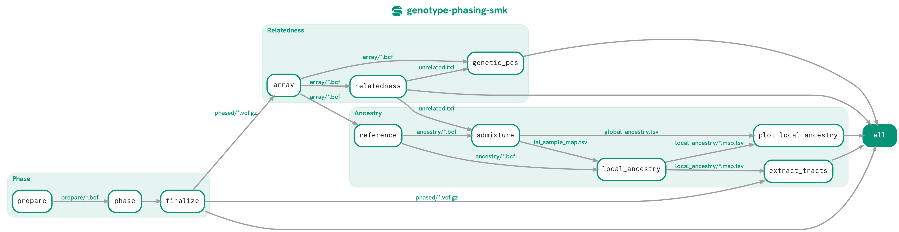

# genotype-phasing-smk

A [Snakemake](https://github.com/snakemake/snakemake) pipeline that phases a
joint-genotyped WGS callset and derives the genotype inputs of QTL mapping.

## Description

The workflow reads one joint-called VCF, such as the output of
[joint-genotyping-smk](https://github.com/ramirc0/joint-genotyping-smk). It
filters each chromosome and phases it against the HGDP+1kGP panel with SHAPEIT5
or Eagle2. On chrX, samples with one X are phased as haploid outside the PARs.
The phased genotypes then feed KING relatedness, genetic PCs, ADMIXTURE global
ancestry, local ancestry with RFMix2 or gnomix, and Tractor's per-ancestry
dosages. Trait QC and QTL mapping stay in per-omics pipelines. Profiles run it
on one host or on SLURM.



Each box merges related rules. `phase` runs SHAPEIT5 or Eagle2, and
`local_ancestry` runs RFMix2 or gnomix. [docs/PIPELINE.md](docs/PIPELINE.md)
describes every rule and output, with the full rule graph.

## Getting Started

### Dependencies

- Linux on x86-64 and [pixi](https://pixi.sh) on `PATH`. pixi installs
  everything else.
- Network access to GitHub. Snakemake and its plugins install from git.
- A SLURM cluster for `profiles/slurm`.

### Installing

```bash
git clone https://github.com/ramirc0/genotype-phasing-smk.git
cd genotype-phasing-smk
pixi install
pixi run fetch-resources <resources_dir>   # panel, maps, array manifest, about 20 GB
```

### Executing program

- Copy the config and exclusion templates into `config/<run_id>/`, then edit
  both.
- Dry-run, then run locally or on SLURM.

```bash
mkdir -p config/<run_id>
cp config/config.yaml.template config/<run_id>/config.yaml
cp config/exclude_samples.tsv.template config/<run_id>/exclude_samples.tsv
pixi run slurm <run_id> "-n"   # dry run
pixi run slurm <run_id>
```

[docs/GETTING_STARTED.md](docs/GETTING_STARTED.md) is the detailed guide:
environments, resources, config keys, local runs, tests, layout and
conventions.

## Help

- Every rule reran. Any change to the rule env manifest or lock reruns every
  rule. So does moving the workdir, because the env hash includes the
  workspace's absolute path.
- A job failed. The profiles set `--show-failed-logs`. The full log sits under
  `logs/<run_id>/`.
- A SLURM node keeps failing jobs. List it under `slurm-exclude-failed-nodes`
  in `profiles/slurm/config.yaml`.

## Authors

Christian Ramirez ([@ramirc0](https://github.com/ramirc0))

## License

This project is licensed under the MIT License. See [LICENSE](LICENSE). `workflow/scripts/vendor/extract_tracts.py` comes
from [Tractor](https://github.com/Atkinson-Lab/Tractor) under its MIT license.
See [THIRD_PARTY_LICENSES](THIRD_PARTY_LICENSES).

## Acknowledgments

- [snakemake-template](https://github.com/ramirc0/snakemake-template)
- [Nextstrain Snakemake style guide](https://docs.nextstrain.org/en/latest/reference/snakemake-style-guide.html)
- [snakemake-software-deployment-plugin-pixi](https://github.com/cademirch/snakemake-software-deployment-plugin-pixi)
