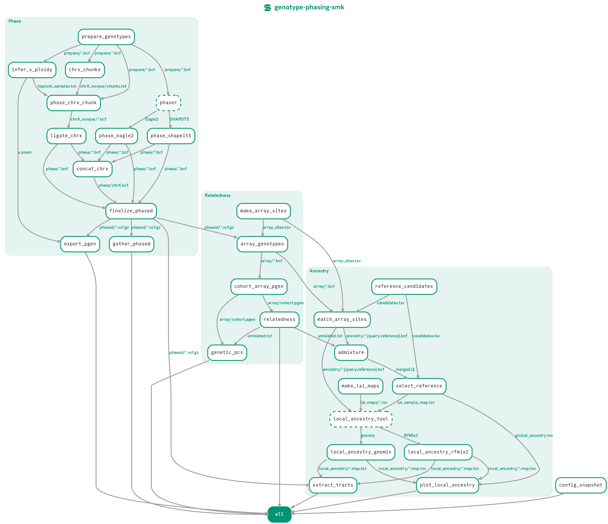

# Pipeline

What each rule does, why, and what it writes. [GETTING_STARTED.md](GETTING_STARTED.md)
covers setup, resources and config.

## Input

One joint-called VCF with a `.tbi`. It MUST code every genotype as diploid,
chrX included, as GATK joint genotyping at ploidy 2 does. Relatives stay in
phasing. `unrelated.txt` filters samples at mapping.

## Per chromosome

1. `prepare_genotypes` keeps PASS records and drops the samples in
   `exclude_samples`. It splits multiallelics with the other ALT set missing, so
   no sample gains a REF allele it lacks, and drops `*` alleles. Genotypes with
   depth below `min_dp` go missing. Sites below `min_maf` or above
   `max_missing` are dropped. Only GT is kept.
2. The phaser set by `phaser` phases against the reference panel and imputes
   missing genotypes. The panel lacks some common cohort sites, which its own
   QC removed though other callsets keep them.
   - `phase_shapeit5` (default) runs SHAPEIT5 `phase_common` twice. The first
     pass phases against the panel, where panel and cohort haplotypes condition
     each other, and leaves out the sites the panel lacks. The second pass
     phases every site from the cohort alone, holding the first pass's phase
     fixed as a scaffold, so no site is lost. The SHAPEIT5 docs skip
     `phase_rare` below 2,000 samples.
   - `phase_eagle2` runs Eagle2. It drops the sites the panel lacks, and its
     log counts them. Eagle's auto rule runs one iteration when the cohort is
     under half the panel, which phases each sample against the panel alone.
     The rule sets `--pbwtIters 2`, so cohort haplotypes inform each other.
3. `finalize_phased` recomputes AC, AN, AF and MAF and sets each ID to
   `CHROM:POS:REF:ALT`. `gather_phased` joins the chromosomes into one
   genome-wide VCF.
4. `export_pgen` writes a plink2 pgen copy, which keeps the phase. Its
   chromosome codes drop the `chr` prefix.

## chrX

With `chrX` in `chromosomes`, chrX runs as three regions split at the GRCh38
PAR bounds, because samples with one X are haploid only between them:

- `infer_x_ploidy` imputes each sample's sex from its X F-statistic with plink2
  on the prepared non-PAR genotypes. The F-statistic counts X copies, which is
  what phasing needs: XY, XYY and X0 samples come out haploid, and XX, XXY and
  XXX samples diploid. Samples plink2 cannot call stay diploid.
- The non-PAR runs in `chrx_chunks.count` chunks of equal site counts that
  overlap by `chrx_chunks.overlap_sites`. With haploid samples, SHAPEIT5's
  memory on the whole non-PAR grows faster than its span, past 243 GB for 936
  samples, against 16 GB for chr1. `phase_chrx_chunk` runs both passes on each
  chunk and passes the haploid samples to `--haploids`. SHAPEIT5 sets their
  hets missing and imputes them as homozygous. `ligate_chrx` joins the chunks
  with `SHAPEIT5_ligate`, which aligns phase on the overlaps.
- `concat_chrx` joins the three regions before `finalize_phased`.
- `export_pgen` splits the PARs with `--split-par hg38` and takes the imputed
  sex, so PAR calls stay diploid in every sample.

chrX needs `phaser: shapeit5`. Eagle2 takes haploid calls, but RFMix2, Tractor
and the SHAPEIT5 panel code them as diploid.

## Across the genome

5. `make_array_sites` reads the autosomal SNP positions from the array
   manifest once, into `results/refs/`. `array_genotypes` keeps the phased
   SNPs at those positions, and relatedness, PCs and local ancestry run on
   them. A split multiallelic site leaves several SNP records at one position,
   and RFMix2 matches records by position alone, so only positions with one
   SNP record are kept. `cohort_array_pgen` joins the chromosomes into one
   pgen.
6. `relatedness` computes KING-robust kinship with plink2, which tolerates
   population structure. `--king-cutoff` drops a sample from each pair above
   `kinship_cutoff` and writes the rest to `unrelated.txt`.
7. `genetic_pcs` computes PCs from the unrelated samples, on SNPs with MAF of
   at least 5% outside long-range LD regions, pruned to r² < 0.1 in 1 Mb
   windows. It then projects every sample, so relatives get PCs on the same
   scale.
8. `reference_candidates` lists the panel samples of the populations in
   `local_ancestry.populations` that gnomAD does not flag as related.
   `match_array_sites` keeps the array SNPs whose REF and ALT agree exactly
   between the cohort and the candidates, because RFMix2 matches records by
   position alone.
9. `admixture` runs unsupervised ADMIXTURE on the unrelated cohort samples and
   the candidates, with one component per ancestry, on pruned common SNPs.
   `select_reference` matches ancestries to components one to one, by the
   matching with the largest summed mean share of each ancestry's candidates.
   A candidate joins the reference when its share of its own ancestry's
   component exceeds `local_ancestry.min_purity`. The cohort's shares go to
   `global_ancestry.tsv`.
10. The tool set by `local_ancestry.tool` calls local ancestry per chromosome.
    Both tools read the same files and write msp files in RFMix2's layout, which
    Tractor reads.
    - `local_ancestry_rfmix2` (default) runs RFMix2.
    - `local_ancestry_gnomix` runs gnomix. It trains a model on admixed samples
      that it simulates from the reference, then deletes them. Phase correction
      stays off, so its haplotypes stay those of the phased VCF.
11. `extract_tracts` runs Tractor's `extract_tracts.py` on each phased VCF and
    its msp file. It writes, per ancestry, the ALT dosage and the haplotype
    count of each sample at every phased site, which Tractor's regression reads.
    The local ancestry query comes from the phased VCF, so samples and
    haplotypes line up. Sites outside every msp window are skipped.
12. `plot_local_ancestry` draws both haplotypes of every chromosome for 10
    random samples, so tract lengths can be checked before mapping. It draws
    them as plain bars. `plots/ideograms.pdf` gives `local_ancestry.pdf_samples`
    samples a page each, with both homologs of every autosome on banded hg38
    chromosomes drawn by [pqplot](https://github.com/ramirc0/pqplot), where
    unpainted bands show stretches without calls. It sums
    each sample's tracts into genome-wide shares and plots them against
    ADMIXTURE.

## Outputs

Everything goes under `results/<run_id>/`. Logs and benchmarks go to
`logs/<run_id>/` and `benchmarks/<run_id>/`.

| Path | Contents |
|---|---|
| `prepare/<chrom>.bcf` | Filtered genotypes, the phaser's input |
| `phase/<chrom>.bcf` | Phaser output; with chrX, also one file per chrX region, and the non-PAR chunks and their spans in `phase/chrX_nonpar/` |
| `phased/<chrom>.vcf.gz` | Phased genotypes with recomputed tags and `CHROM:POS:REF:ALT` IDs |
| `phased/genome.vcf.gz` | Every chromosome's phased VCF joined in order, chr1 to chr22 then chrX, with a `.tbi` |
| `pgen/<chrom>.{pgen,pvar,psam}` | plink2 copy of the phased genotypes |
| `x_ploidy.tsv` | plink2 sex imputation: X F-statistic and imputed sex per sample (chrX runs only) |
| `haploid_samples.txt` | Samples with one X, phased as haploid outside the PARs (chrX runs only) |
| `array/<chrom>.bcf` | Phased genotypes at array SNPs |
| `array/cohort.{pgen,pvar,psam}` | Array-site genotypes of all chromosomes |
| `king.kin0` | Sample pairs with KING kinship above `kinship_cutoff` |
| `unrelated.txt` | Sample IDs of the unrelated set, one per line |
| `pcs.tsv` | `num_pcs` genetic PCs of every sample |
| `pcs.eigenval` | Eigenvalues of those PCs |
| `ancestry/candidates.tsv` | Reference candidates: sample, population, ancestry |
| `ancestry/<chrom>.{query,reference}.bcf` | Cohort and candidates at the matched array SNPs |
| `admixture/merged.*` | ADMIXTURE input and its `.Q` and `.P` files |
| `lai_sample_map.tsv` | Local ancestry reference: sample, ancestry |
| `global_ancestry.tsv` | ADMIXTURE share per ancestry of each unrelated cohort sample |
| `local_ancestry/<chrom>.{msp,fb}.tsv` | Local ancestry calls in RFMix2's layout |
| `local_ancestry_global.tsv` | Genome-wide share per ancestry of each sample, from its tracts |
| `tracts/<chrom>.anc<i>.{dosage,hapcount}.txt.gz` | Tractor input per ancestry `i`, numbered as in the msp header |
| `plots/karyograms.{svg,png}` | Local ancestry of 10 random samples |
| `plots/ideograms.pdf` | One page per sample (`local_ancestry.pdf_samples`): its local ancestry on banded hg38 chromosomes, homologs side by side, with genome-wide shares in the title. Each page has a bookmark and a page label named after its sample, so the outline or the page box jumps to a sample. |
| `plots/global_ancestry.{svg,png}` | Genome-wide shares from local calls against ADMIXTURE |
| `config.snapshot.json` | The resolved config, `--config` overrides included. Rerun it with `--configfile results/<run_id>/config.snapshot.json`. |
